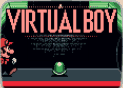
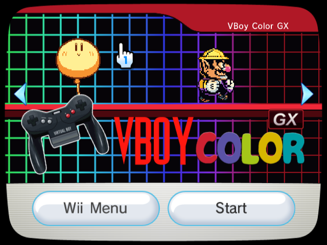
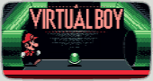
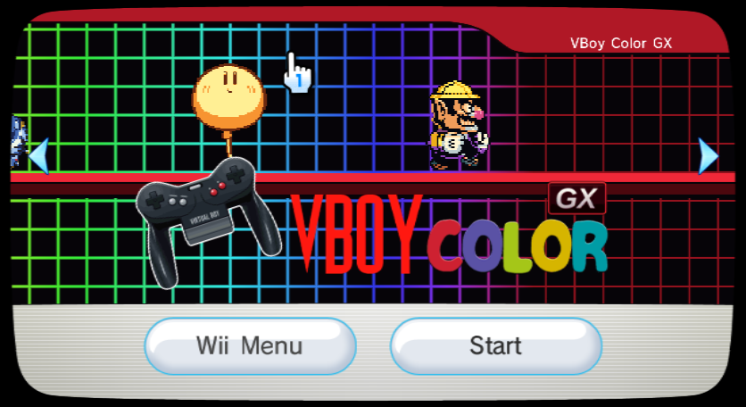

# VBoy Color GX Forwarder Channel

A Wii channel that boots straight into [**VBoy Color GX**](https://github.com/cmyksoda/vbcgx), the Wii port of VBoy Color, a Virtual Boy emulator that adds color.

## Screenshots

<table>
  <thead>
    <tr>
      <th width="50%">4:3 Icon</th>
      <th width="50%">4:3 Banner</th>
    </tr>
  </thead>
  <tbody>
    <tr>
      <td></td>
      <td></td>
    </tr>
  </tbody>
</table>

<table>
  <thead>
    <tr>
      <th width="50%">16:9 Icon</th>
      <th width="50%">16:9 Banner</th>
    </tr>
  </thead>
  <tbody>
    <tr>
      <td></td>
      <td></td>
    </tr>
  </tbody>
</table>

## Requirements

- **IOS58** — update to System Menu 4.3, or use the [IOS58 Installer](https://wiibrew.org/wiki/IOS58_Installer).
- **VBoy Color GX installed to `apps/vbcgx/boot.dol`** on SD or USB.

| Title ID | Region | NAND Blocks |
|---|---|---|
| VBCG (0001000156424347) | Free | 14 (Wii), 12 (vWii) |

## Install

> **Install BootMii and/or Priiloader first.** I took time to make sure that this `.wad` is safe, but one should always have protections in place in case of a banner brick.

1. Download the `.zip` for your console from the releases page and extract the `.wad` inside.
2. Install using the WAD manager of your choice.
3. Ensure VBoy Color GX is installed to `apps/vbcgx/boot.dol` on SD or USB — that exact folder name.

## Uninstall

- Use the WAD manager you used to install the channel to uninstall it, or, delete it from the Wii system settings.

## Repository contents

| path | |
|---|---|
| `audio/` | source for the banner sound |
| `banner/` | the banner's character sprites, and the controller vector (`vbcontroller.svg`) |
| `build/` | the Python toolchain that rebuilds everything |
| `icon/` | the icon's stage pieces, sprites and logos |
| `preview/` | the icon animation as GIFs and the banner as stills, captured on the real Wii Menu |
| `splash/` | forwarder loading screens (4:3 and 16:9) |
| `BUILDING.md` | how to rebuild, and what was changed in the GPL'd components |

The banner song starts with twelve samples of silence, so that its loop lands exactly on a codec frame. Can you hear them?

## Credits

### Emulator forwarded to

- [**VBoy Color GX**](https://github.com/cmyksoda/vbcgx), built on [**VBoy Color**](https://github.com/yuk27/VBoyColor) by **yuk27** and contributors, **Beetle VB** (Mednafen's Virtual Boy core) by **Ryphecha** and contributors, and Tantric's **FCE Ultra GX** frontend.
- The VBoy Color logo artwork is by **Juan**, from the VBoy Color project, with the "GX" mark added by me.

### Channel base

**FCE Ultra GX Channel** — donor for the banner archive, the NAND loader stub and the forwarder; the vWii build takes its NAND loader and forwarder from the **FCE Ultra GX vWii Channel**.

*Two PNG files and the path pointing towards the boot.dol have been changed.*
- **wilsoff**: coding
- **MrNick666**: artwork
- **Tantric**: forwarder and installer
- **svpe** and **megazig**: installer exploit

### Sprites

**Every sprite and stage piece was captured from VBoy Color GX itself, in VBoy Color's colors.**

*All games and characters are the intellectual property of their owners: Mario Clash and Virtual Boy Wario Land of Nintendo, Panic Bomber of Hudson Soft (now Konami), Jack Bros. of Atlus, and Space Invaders Virtual Collection of Taito.*

### Graphics and sound

- The Virtual Boy controller is a vector traced from VBoy Color GX's controller icon, which is from a photo by **Sesu Prime** with a cutout by **JohnnyMrNinja**, under [CC BY-SA 3.0](https://creativecommons.org/licenses/by-sa/3.0/). The vector is shared under the same license.
- The rainbow grid and the stripes are my own work.
- Virtual Boy and its logo are the intellectual property of Nintendo.
- The banner song is my own, made from three loops by users on Looperman: [this synthwave melody](https://www.looperman.com/loops/detail/378478/synthwave-melody-free-130bpm-electronic-synth-loop) by user mawlr, [this progressive house kick](https://www.looperman.com/loops/detail/402950/progressive-house-kick-free-130bpm-house-drum-loop) by user Ringy345XXX, and [this trap drum loop](https://www.looperman.com/loops/detail/433174/bump-drums-free-130bpm-trap-drum-loop) by user T3Voon.
- The splash screens' lettering is set in **Fredoka**, © 2016 The Fredoka Project Authors, under the [SIL Open Font License 1.1](build/fonts/Fredoka-OFL.txt).

### Tools used

- **Benzin 2.1.12BETA** by **SquidMan (Alex Marshall)**, **comex** and **megazig**, © 2009 HACKERCHANNEL
- **Inkscape**, for the controller vector, and **NumPy**, **SciPy** and **Pillow**, which the Python tools use
- **Dolphin**, for testing on the real Wii Menu
- Everything else is in `build/tools/`: a Python implementation of the WAD container, U8, LZ77, IMD5/IMET, TPL and a DSP ADPCM encoder, a renderer for the layouts, the build for the icon, banner, banner song and splash screens, and the checks every WAD has to pass.

## License

The parts of this repository that are mine — the build toolchain in `build/`, the channel art, and the documentation — are free software under the [GNU General Public License, version 3 or later](LICENSE).

This channel is built out of other people's work, which stays under the licenses it came with:

- the forwarder, banner archive and icon are derived from [FCE Ultra GX](https://github.com/dborth/fceugx), which is GPL
- the controller vector is derived from a photo under [CC BY-SA 3.0](https://creativecommons.org/licenses/by-sa/3.0/), and stays under it
- the Fredoka font in `build/fonts/` is under the [SIL Open Font License 1.1](build/fonts/Fredoka-OFL.txt), which sits beside it
- the emulator it launches, [VBoy Color GX](https://github.com/cmyksoda/vbcgx), is GPL version 3, my own project, and is not redistributed here

The games' sprites are used for a non-commercial fan project and are not covered by any of the above; they remain the property of their owners.

---

*This project was made with AI assistance. For more information, see [my AI usage statement](https://github.com/cmyksoda/cmyksoda/blob/main/AI_USAGE.md).*
